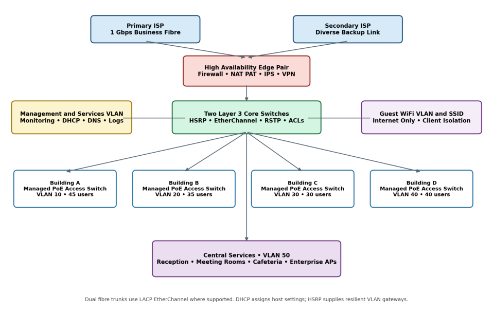

# TechPoint Business Park Network Design

A scenario-based technical proposal to modernise a shared campus network serving four businesses and 150 employees. The design addresses capacity, availability, tenant separation, wireless coverage and operational management.

**Author:** Tirth Patel  
**Project type:** Network architecture and implementation planning  
**Status:** Proposed design; not a deployed or benchmarked network

## Read the proposal

[Download the network modernisation proposal](docs/TechPoint_Network_Modernisation_Proposal.pdf)

The report includes an executive summary, scope, investigation procedures, findings, conclusions, recommendations, architecture illustration, VLAN/addressing plan, implementation phases, risks, acceptance criteria and requirements traceability.

The public copy removes student and college/course identifiers. Its contents page has been refreshed, the contradictory wireless description has been corrected, and the schedule now reflects the sum of the listed phase durations.

## Scenario and business problem

TechPoint is a fictional business park with four tenant companies:

| Building | Tenant type | Employees |
| --- | --- | ---: |
| A | Software development | 45 |
| B | Marketing | 35 |
| C | Accounting | 30 |
| D | IT consulting | 40 |

Reception, meeting rooms and a cafeteria form Central Services. The scenario describes a single shared 50 Mbps fibre connection, ageing mixed-vendor equipment, damaged cabling, consumer wireless devices, limited firewall policy and inconsistent administration.

Reported symptoms include slow file transfers, unstable video calls, peak-hour congestion, wireless dropouts, outages, power-related interruptions and insufficient tenant/guest separation. These are scenario inputs, not measurements collected from a real customer site.

## Proposed architecture



The illustration is retained from the supplied report, where it is labelled AI-generated. It is a conceptual overview rather than a port-level topology, validated cabling plan or equipment specification.

| Layer or service | Proposed approach | Intended outcome |
| --- | --- | --- |
| Internet access | Business-grade symmetric 1 Gbps fibre and a diverse secondary connection | Increase capacity and provide an alternative external path |
| Perimeter | High-availability next-generation firewall pair | Centralise filtering, NAT/PAT, remote access and internet failover |
| Core | Two Layer 3 switches with HSRP | Provide resilient VLAN default gateways |
| Inter-building links | Fibre uplinks, with LACP bundles where supported | Improve link capacity and resilience |
| Access | Managed PoE switches and tested Cat6 cabling | Support consistent endpoint and access-point connectivity |
| Loop prevention | Rapid Spanning Tree | Control switching loops and support convergence |
| Wireless | Survey-led enterprise Wi-Fi 6 or newer access points | Improve coverage, roaming, capacity and central administration |
| Staff authentication | WPA3-Enterprise and 802.1X where supported | Strengthen wireless identity controls |
| Guest access | Dedicated guest SSID/VLAN with client isolation | Restrict visitors to authorised internet access |
| Operations | Monitoring, central logs, configuration backups and UPS protection | Improve visibility, recoverability and service continuity |

Final equipment, access-point quantities, fibre paths, power requirements and supplier costs depend on a site survey, detailed design and approval. The 1 Gbps service is a proposed starting point, not a measured sizing result.

## Proposed VLAN and addressing plan

| VLAN | Purpose | Example subnet | Intended policy |
| --- | --- | --- | --- |
| 10 | Building A | `10.20.10.0/24` | Tenant users and explicitly approved shared services |
| 20 | Building B | `10.20.20.0/24` | Tenant users and explicitly approved shared services |
| 30 | Building C | `10.20.30.0/24` | Tenant users and explicitly approved shared services |
| 40 | Building D | `10.20.40.0/24` | Tenant users and explicitly approved shared services |
| 50 | Central Services | `10.20.50.0/24` | Shared facilities and approved operational services |
| 60 | Guest Wi-Fi | `10.20.60.0/23` | Internet only; client isolation |
| 99 | Network management | `10.20.99.0/24` | Authorised administrators and infrastructure devices |

These are preliminary subnets. The final plan must account for printers, phones, servers, building systems, existing static addresses and growth. VLAN separation must be enforced with routing, ACL and firewall policy; VLAN labels alone do not establish isolation.

## Implementation plan

| Phase | Work package | Estimate |
| --- | --- | --- |
| 1 | Initiation, scope and success measures | 1 week |
| 2 | Site survey and requirements | 1 week |
| 3 | Detailed network and security design | 2 weeks |
| 4 | Procurement and staging | 2 weeks |
| 5 | Cabling, power and infrastructure improvements | 2 weeks |
| 6 | Configuration and pilot | 2 weeks |
| 7 | Building-by-building migration | 2 weeks |
| 8 | Testing and staff training | 1 week |
| 9 | Handover and closure | 1 week |

The phase estimates total **14 weeks before overlaps**. Any shorter calendar schedule must validate dependencies, procurement lead times and approved parallel work. Migration follows an accepted pilot and rollback plan.

## Risk and acceptance planning

The proposal addresses migration outages, supplier/ISP delays, incorrect VLAN or firewall rules, configuration loss, budget overrun, inadequate wireless coverage, power failures and user disruption.

Acceptance criteria call for documented checks of:

- Correct DHCP settings and permitted access for every tenant.
- Blocked unauthorised tenant-to-tenant and guest-to-business traffic.
- Agreed wired throughput, wireless coverage, roaming and load performance.
- HSRP, EtherChannel, switching and ISP failover behaviour.
- NAT/PAT operation, monitoring, logging and UPS visibility.
- Current diagrams, labelled infrastructure, configuration backups and handover records.

The report also proposes a 30-day review against pre-upgrade baselines. No successful execution of these future tests is claimed in this repository.

## Repository contents

```text
TechPoint-Business-Park-Network-Design/
├── README.md
├── docs/
│   └── TechPoint_Network_Modernisation_Proposal.pdf
└── assets/
    └── proposed-architecture.png
```

The original scenario sheet, marking rubrics and unrelated career/application files are excluded. No Packet Tracer simulation, production configuration, procurement quotation or implementation source code was supplied for this proposal.

## Skills represented

Requirements analysis, technical writing, campus network architecture, subnetting, VLAN segmentation, resilience planning, wireless design, security policy planning, work breakdown structures, risk management, acceptance criteria and requirements traceability.
